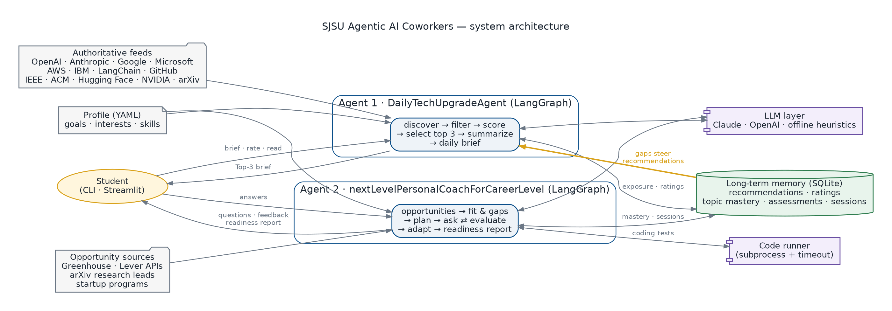

# SJSU Agentic AI Coworkers

Two personalized LangGraph agents that share one memory:

- **DailyTechUpgradeAgent** picks the three best technical articles for you each day from OpenAI, Anthropic, Google, Microsoft, AWS, IBM, LangChain, GitHub, IEEE, ACM, arXiv and more, and turns them into a 15–20 minute learning brief.
- **nextLevelPersonalCoachForCareerLevel** finds internships, jobs, research and startup opportunities, interviews you (concepts, system design, coding with hidden tests, behavioral), grades your answers, and writes a Career Readiness Report that tracks your progress.

The full assignment write-up (goals, architecture, sample results, evaluation) is in **[REPORT.md](REPORT.md)**.



## Quick start

Requires Python 3.10+.

```bash
pip install -r requirements.txt
cp .env.example .env              # optional: add ANTHROPIC_API_KEY or OPENAI_API_KEY
```

No key? Everything still works in offline mode, using extractive summaries and rubric grading.

```bash
# Agent 1
python -m coworkers.cli brief                     # live feeds -> output/daily_brief_<date>.md
python -m coworkers.cli rate "<article url>" 5    # teach it what you like
python -m coworkers.cli read "<article url>"      # record what you read

# Agent 2
python -m coworkers.cli opportunities             # ranked opportunities with fit and gaps
python -m coworkers.cli coach                     # interactive interview (6 questions)
python -m coworkers.cli coach --focus rag,evaluation --questions 8
python -m coworkers.cli progress                  # readiness and mastery over time

# Web UI for both agents
streamlit run app.py
```

Make it yours by editing [`config/profile.yaml`](config/profile.yaml): career goal, target roles, interests, honest skill self-ratings, and the job boards to watch.

## Reproduce the submission

```bash
./scripts/run_demo.sh          # regenerates samples/ (two briefs, two coaching sessions, reports, progress)
python -m pytest -q            # 19 tests
python -m eval.evaluate        # eval/EVAL_RESULTS.md
python scripts/make_diagrams.py
```

## Project layout

```
coworkers/
  llm.py, memory.py, profile.py, taxonomy.py   shared: LLM layer, SQLite memory, profile, topic vocabulary
  tech_upgrade/                                Agent 1: sources, fetch, scoring, summarize, brief, graph
  career_coach/                                Agent 2: opportunities, analyzer, question_bank, evaluator, report, graph
  cli.py                                       command-line interface
app.py                                         Streamlit UI
config/profile.yaml                            your goals, interests and skills
data/fixtures/                                 article snapshot, sample job postings, scripted demo answers
data/eval/                                     labeled data for evaluation
eval/evaluate.py                               evaluation harness
samples/                                       generated sample results
docs/diagrams/                                 architecture diagrams (PNG, SVG, Graphviz, LangGraph Mermaid)
tests/                                         pytest suite
```

## Notes

- **Feeds change.** Run `python -m coworkers.cli sources --check` and update `coworkers/tech_upgrade/sources.py` if a feed moves.
- **Job boards.** The Greenhouse board tokens in the profile are examples; check each company's careers page.
- **Coding answers run locally** in a separate Python process with a 5-second timeout. This is fine for your own answers but is not a security sandbox.
- **Sample data.** The article snapshot contains real articles found on 2026-11-01. The job postings in `data/fixtures/sample_jds.json` are synthetic and labeled "(sample)".
