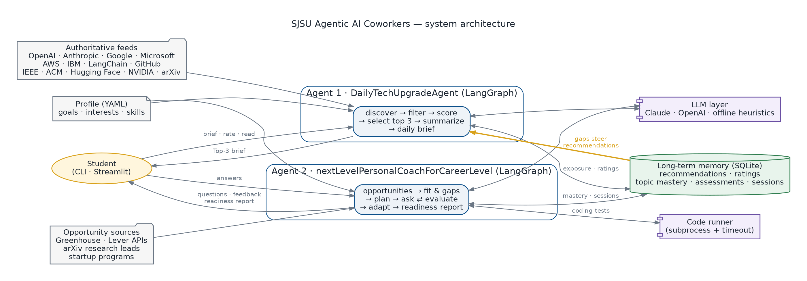
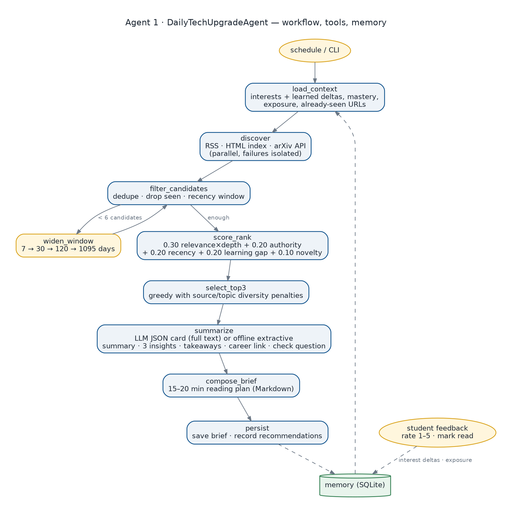
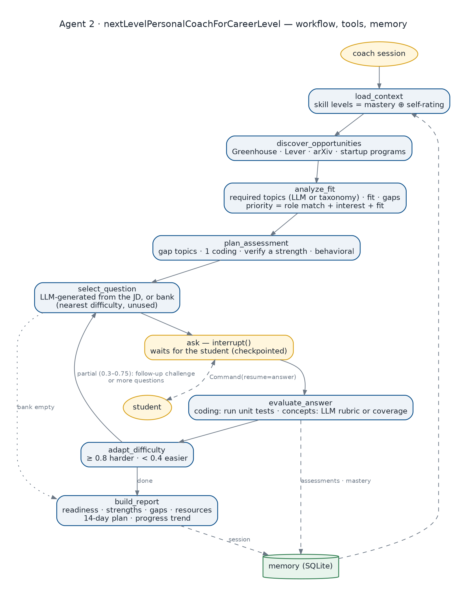

# Agentic AI Coworkers — Assignment Report

San José State University · Agentic AI assignment (class discussion of October 15, 2026)

This project delivers two personalized AI coworkers built as LangGraph agents that share one long-term memory:

- **DailyTechUpgradeAgent** finds, ranks and explains the three best technical articles for you each day.
- **nextLevelPersonalCoachForCareerLevel** finds opportunities, interviews you interactively, grades your answers, and tracks your readiness over time.

The two agents are deliberately connected. Gaps the coach measures in an interview raise the "learning gap" weight that the daily agent uses to rank articles, and what you read raises topic exposure that the coach sees. Learning and career preparation become one loop instead of two separate tools.

Contents: [1. Agent goals](#1-agent-goals) · [2. Architecture](#2-architecture) · [3. Working prototype](#3-working-prototype) · [4. Sample results](#4-sample-results) · [5. Evaluation](#5-evaluation) · [6. Limitations and next steps](#6-limitations-and-next-steps)

---

## 1. Agent goals

### Agent 1 — DailyTechUpgradeAgent

**Purpose.** Make me a better technical learner every day by turning the flood of AI and engineering publications into a focused 15–20 minute reading session matched to my goals.

**Expected outcomes**

| Requirement | How the agent meets it |
|---|---|
| Three relevant, high-quality articles daily | Scans 15 authoritative sources (OpenAI, Anthropic, Google, Microsoft, AWS, IBM, LangChain/LangGraph, GitHub, IEEE Spectrum, Communications of the ACM, Hugging Face, NVIDIA, arXiv), ranks every candidate, and selects three with diversity constraints |
| Summaries with key insights and takeaways | Each pick gets a summary, three technical insights, two takeaways and a check question |
| Titles, dates, sources, URLs | Shown in the reading-plan table and on every article card |
| Contribution to knowledge and career goals | "How this builds your knowledge" and "Career link" sections tie each article to the profile's career goal |
| Personalization by interests and progress | Ranking uses profile interests, learned rating adjustments, measured topic mastery (from Agent 2) and reading exposure |
| 15–20 minute brief | Minutes are allocated across the three articles plus a two-minute reflection, always totalling 15–20 |

**Success criteria.** nDCG@3 ≥ 0.80 against my relevance labels; 100% of picks from authoritative sources; three distinct organizations; every insight grounded in the source text; ratings measurably change future rankings.

### Agent 2 — nextLevelPersonalCoachForCareerLevel

**Purpose.** Prepare me for my next career milestone — an AI-engineering internship for Summer 2027 — or an entrepreneurial path, by measuring readiness honestly and telling me exactly what to do next.

**Expected outcomes**

| Requirement | How the agent meets it |
|---|---|
| Internships, jobs, research, entrepreneurial opportunities | Greenhouse and Lever public job APIs, arXiv research leads, startup programs from the profile; each classified by type |
| Analyze job descriptions and learning materials | Extracts the skill areas a posting emphasizes (LLM extraction or keyword taxonomy), computes fit and ranked gaps |
| Personalized questions, coding exercises, interview scenarios | Plans each session around the target role's gaps: concept, system-design, coding (with hidden unit tests) and behavioral questions; with an API key, questions are generated from the posting itself |
| Interactive questioning and evaluation | The graph pauses with `interrupt()` for each answer, grades it, and asks a follow-up challenge when the answer is partially right |
| Strengths, gaps, improvement areas | Per-topic scores, strengths (≥ 75%), gaps (< 60%) and the specific ideas each answer missed |
| Resources and action plan | Curated resources per gap and a dated 14-day plan (learn → practice → build → re-assess) |
| Progress tracking | Sessions, per-topic mastery and readiness persist in memory; each report shows the trend |

**Success criteria.** Automatic grades agree with a human interviewer (mean absolute error ≤ 0.20, Spearman ≥ 0.70); coding grader catches every buggy solution; ≥ 80% of technical questions target the role's required skills; readiness increases when answers improve.

---

## 2. Architecture

### System overview



| Layer | Implementation | Notes |
|---|---|---|
| Orchestration | LangGraph `StateGraph` (v1.2) | Conditional loops, `interrupt()` human-in-the-loop, `MemorySaver` checkpointer |
| Reasoning | `coworkers/llm.py` | Claude or OpenAI when a key is set; deterministic offline heuristics otherwise, so the project runs and is tested at zero cost |
| Short-term memory | LangGraph state + checkpointer | Holds a run's candidates or a coaching session's questions, answers and difficulty; lets a session pause for a human and resume |
| Long-term memory | SQLite (`coworkers/memory.py`) | Recommendations, ratings, learned interest deltas, topic exposure and mastery, every assessment, every session |
| Profile | `config/profile.yaml` | Goals, target roles, interests, self-rated skills, job boards |
| Shared vocabulary | `coworkers/taxonomy.py` | 14 skill topics both agents use, which is what lets them exchange signals |

### Agent 1 workflow



The ranking formula is explicit so it can be explained and tuned:

```
score = 0.30 × relevance (topic match to interests × content-depth confidence)
      + 0.20 × source authority
      + 0.20 × recency (14-day half-life)
      + 0.20 × learning gap (interest × (1 − mastery))
      + 0.10 × novelty (topics read less recently)
```

Selection is greedy with penalties for repeating an organization or a primary topic. If fewer than six fresh, unseen candidates exist, the graph loops through `widen_window` (7 → 30 → 120 → 1095 days), so older articles appear only as labeled foundational reads.

### Agent 2 workflow



Key mechanisms:

- **Human in the loop.** `ask` calls `interrupt()`; the checkpointer saves state; the CLI or web UI resumes with `Command(resume=answer)`. Selection happens in a separate node so nothing is re-executed on resume.
- **Grading.** Coding answers are executed against unit tests in a subprocess with a timeout; conceptual answers are graded by an LLM against a rubric or, offline, by rubric coverage with a penalty for keyword-only answers.
- **Adaptivity.** A score ≥ 0.8 raises that topic's difficulty, < 0.4 lowers it; a score between 0.3 and 0.75 triggers a follow-up challenge on the same idea (up to two per session).
- **Calibrated readiness.** `readiness = 0.6 × assessment (weighted by the posting) + 0.4 × skill fit`. Measured mastery is blended with the self-rating prior, so one answer moves an estimate without setting it outright, and the report states what share of the role has actually been assessed.

The compiled LangGraph graphs are also exported automatically as Mermaid (`docs/diagrams/langgraph_*.mmd`), so the diagrams can be checked against the running code.

---

## 3. Working prototype

Everything runs offline; an API key upgrades summaries, question generation and grading.

```bash
pip install -r requirements.txt
python -m coworkers.cli brief                                   # Agent 1, live feeds
python -m coworkers.cli brief --snapshot data/fixtures/articles_snapshot_2026-11-01.json --date 2026-11-01
python -m coworkers.cli rate "<url>" 5                          # feedback -> personalization
python -m coworkers.cli coach                                   # Agent 2, interactive interview
python -m coworkers.cli progress                                # readiness and mastery over time
streamlit run app.py                                            # web UI for both agents
./scripts/run_demo.sh                                           # regenerate every sample result
python -m pytest -q && python -m eval.evaluate                  # 19 tests + evaluation
```

| Component | Size |
|---|---|
| Agent code (`coworkers/`) | ~2,000 lines of Python |
| Question bank | 27 questions with rubrics and follow-ups; 4 coding exercises with 20 hidden tests |
| Sources | 15 feeds; 4 opportunity sources |
| Tests | 19 pytest tests covering both graphs, both LLM paths (with a fake LLM), grading and memory |

---

## 4. Sample results

All files in [`samples/`](samples/) are produced by `scripts/run_demo.sh` from a clean memory.

**About the sample data.** The build sandbox could not reach publisher feeds, so the daily briefs use a snapshot of seven real articles located by web search on November 1, 2026 (`data/fixtures/articles_snapshot_2026-11-01.json`); the summaries are paraphrased in my own words. In live mode the agent fetches the feeds directly. The four job postings are synthetic and labeled "(sample)"; live mode uses real Greenhouse and Lever postings. The scripted coaching answers are written to resemble a student's first and second attempts.

### Daily Top 3 — November 1, 2026 ([full brief](samples/daily_brief_2026-11-01.md))

| # | Article | Source | Published | Why it was picked |
|---|---|---|---|---|
| 1 | [Redesigning source control at Anthropic](https://www.anthropic.com/engineering/redesigning-source-control) | Anthropic Engineering | 2026-10-13 | Most recent substantive post; agent-scale infrastructure case study with real numbers |
| 2 | [Build reliable AI agents with Amazon Bedrock AgentCore Evaluations](https://aws.amazon.com/blogs/machine-learning/build-reliable-ai-agents-with-amazon-bedrock-agentcore-evaluations) | AWS Machine Learning Blog | 2026-03-31 | Evaluation is the profile's largest learning gap |
| 3 | [LangChain and LangGraph Agent Frameworks Reach v1.0 Milestones](https://www.langchain.com/blog/langchain-langgraph-1dot0) | LangChain Blog | 2025-10-22 | Directly about the framework this project uses; foundational read |

Excerpt from the first card:

> **Key technical insights.** Scion is centralized and assumes clients are always online, using sparse, virtualized checkouts and an API that lets CI jobs query repository history without keeping a local repository. · Anthropic reports an infrastructure footprint about 200x smaller in CPU and memory than its git-mirroring setup, checkouts in seconds instead of minutes, and a 25% CI CPU capacity win. · …
>
> **Check question.** Why do tools built for human-paced development struggle with agent-paced development?

On **November 2** ([brief](samples/daily_brief_2026-11-02.md)) the agent recommended nothing it had already shown. It picked *Building effective agents*, GitHub's *Building Git infrastructure for agent-scale development*, and Anthropic's *Introducing Contextual Retrieval*, which covers retrieval, a skill the target internship requires and the student rates low (2/5).

### Interactive coaching session ([week 1 transcript](samples/coaching_session_week1_transcript.md))

The coach targeted *AI Engineer Intern, Agent Platform* (highest priority: first-choice role, strong interest alignment) and planned questions around its gaps. An excerpt:

> **Coach:** How would you evaluate an LLM agent before shipping it, and how would you keep evaluating it after launch?
>
> **Student:** I would create a test set of example tasks with the expected result … use an LLM as a judge with a rubric … do some manual review of a sample.
>
> **Coach evaluation:** 67%. Covered: a golden test set; LLM-as-a-judge with a rubric; human review; task success metrics. Missing: regression tests in CI; online monitoring and A/B tests.
>
> **Follow-up challenge:** Give one metric for the agent's *trajectory* (how it got there), not just its final answer.

The session also included a coding exercise (`topo_order` for agent task DAGs), where the student's solution failed one hidden test because it ignored tasks that appear only as dependencies, and the coach reported the exact failing input.

### Career Readiness Report ([week 1](samples/career_readiness_2026-11-01_week1.md) · [week 2](samples/career_readiness_2026-11-08_week2.md))

| | Week 1 (Nov 1) | Week 2 (Nov 8) |
|---|---|---|
| Readiness | 76% | 94% |
| Assessment score | 75% | 97% |
| Skill fit to the role | 77% | 90% |
| Weakest topic | MLOps & deployment (33% on first answer) | MLOps re-tested: 100% |
| Label | Interview-ready with targeted gaps | Interview-ready with targeted gaps — 29% of the role's skills not yet assessed |

Each report contains the ranked opportunity list (internships, a research assistantship, Y Combinator and NSF I-Corps), the posting's skill weights, per-question scores and feedback, strengths, gaps with the specific missed ideas, resources, a dated 14-day plan, and the progress table.

---

## 5. Evaluation

Run with `python -m eval.evaluate`; results in [`eval/EVAL_RESULTS.md`](eval/EVAL_RESULTS.md). Numbers below are from offline mode.

### How effectiveness, accuracy and progress are measured

| Dimension | Agent 1 | Agent 2 |
|---|---|---|
| Effectiveness | nDCG@3 against relevance labels, compared with recency-only and random baselines | Share of technical questions that target the role's required skills; follow-ups triggered |
| Accuracy | Insight sentences grounded in the source text (≥ 70% content-word overlap); authority rate | Grader agreement with human scores on 18 labeled answers (MAE, within ±0.25, Spearman); mutation testing of the coding grader |
| Personalization | Rank change of a topic after ratings | Questions planned from the target posting's measured gaps |
| User progress | Articles read, average rating, topic exposure | Readiness and per-topic mastery across sessions |

### Results

| Metric | Result | Target |
|---|---|---|
| nDCG@3 vs labeled relevance | **0.84** (recency-only 0.53, random 0.58) | ≥ 0.80 |
| Picks from authoritative sources | 100% | 100% |
| Distinct organizations / topics in top 3 | 3 / 3 | 3 / ≥ 2 |
| Planned session length | 18 minutes | 15–20 |
| Insights grounded in source text | 100% | ≥ 90% |
| Rank of the evaluation article after rating evaluation 5/5 and dev tooling 1/5 | 3 → 1 | moves up |
| Grader mean absolute error vs human | **0.16** | ≤ 0.20 |
| Grader within ±0.25 of human | 89% | ≥ 80% |
| Grader rank correlation (Spearman) | 0.84 | ≥ 0.70 |
| Buggy coding solutions detected | 4 / 4 | all |
| Technical questions on the role's required topics | 100% | ≥ 80% |
| Readiness, session 1 → 2 | 76% → 94% | increases |

### What evaluation caught during development

Building the evaluation changed the agents. Each of these was a real defect found by measurement and then fixed:

1. **Keyword density beat substance.** A two-sentence GitHub teaser outranked Anthropic's detailed Scion post. Fix: a content-depth confidence factor on relevance and learning gap.
2. **A weak unit test.** A dot-product solution that ignores vector length passed every `cosine_top_k` test. Mutation testing exposed it; a magnitude-sensitive test was added (detection went from 3/4 to 4/4).
3. **Overconfident readiness.** One perfect answer set a topic's mastery to 100%, and the report called a student "interview-ready" after testing only part of the role. Fix: mastery updates now start from the self-rating prior, reports show evidence coverage, and the top label requires ≥ 80% coverage.
4. **Planning bugs.** A coding slot silently became a concept question when its exercise had been used, and "auto" slots could pick coding questions. Both were fixed and are now covered by tests.

### Threats to validity

- The relevance labels and the 18 human grades were assigned by one person, the author, before running the system. They are a sanity check, not a benchmark; a stronger study would use several raters and report inter-rater agreement.
- The offline rubric grader matches phrasings, so it misses paraphrases. Its largest disagreement was scoring a vague but partly right answer ("an agent is more autonomous") at 0 where a human gave 0.4. The LLM grader is designed for this case and uses the same evaluation set when a key is set.
- The readiness increase is produced by scripted answers, so it demonstrates the tracking mechanism, not real learning. Real progress needs repeated sessions over weeks.

---

## 6. Limitations and next steps

- **Scheduling.** Run the brief daily with cron or a GitHub Action and deliver it by email or Slack.
- **Full-text grounding offline.** Without a key, summaries come from feed abstracts; with a key the agent fetches and summarizes the full article.
- **Code execution safety.** Coding answers run in a separate process with a timeout, which is appropriate for your own answers on your own machine but is not a security sandbox; a container would be needed for untrusted users.
- **Job sources.** Board tokens in the profile are examples to verify; Handshake (common at SJSU) has no public API, so those postings would need manual import.
- **Richer memory.** Spaced repetition for missed ideas and embedding-based article similarity would improve both agents.
